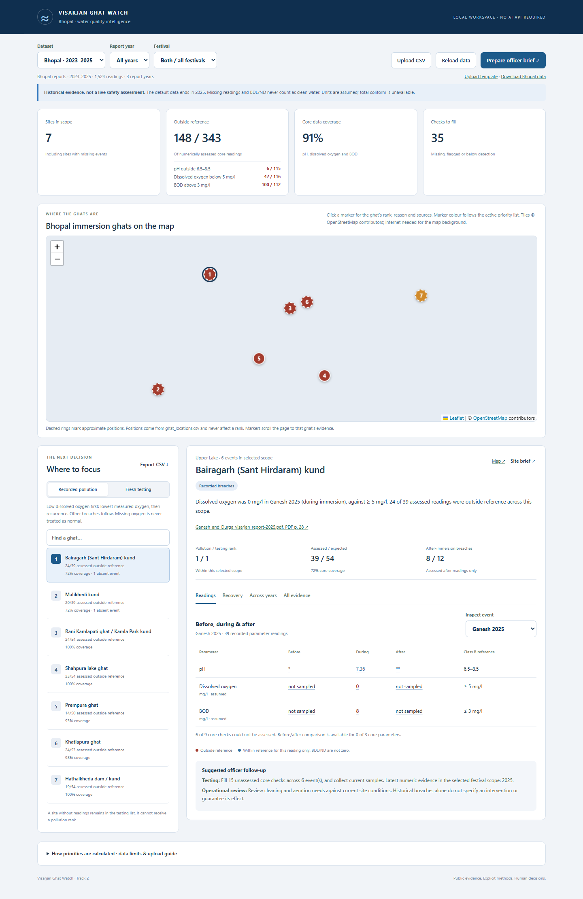

# Visarjan Ghat Watch

**Track 2 · Visarjan Ghat Watch** · Claude Impact Lab × Cerebras Café Compute, Bhopal · 11 October 2026

| | |
|---|---|
| **Team name** | _TEAM NAME HERE_ |
| **Members** | _Name (role) · Name (role) · Name (role) · Name (role)_ |
| **Track** | Track 2: Visarjan Ghat Watch |
| **The one user** | The Bhopal Municipal Corporation (BMC) officer who plans Durga visarjan at the ghats on 20 October 2026 and decides where extra cleaning, aeration and water testing go. |
| **The one workflow** | Open the tool, read the ranked list of ghats, check the evidence behind a rank, forward the Hindi/English brief. |

Three years of MPPCB immersion water tests (2023–2025, Ganesh and Durga, before / during / after) turned into a ranked list of Bhopal ghats, with every number traceable to the report page it came from, and a one-page brief in Hindi and English.



## Run it (3 steps)

Python 3.10 or newer. No third-party packages, API keys or database. Internet is only needed for the map background tiles; everything else works offline.

1. Download or clone this repository.
2. Windows: double-click `start-demo.cmd`. Any OS: run `python server.py` in this folder.
3. Open http://127.0.0.1:8765 in a browser.

A foreground server stops with Ctrl+C. Uploaded CSVs stay in memory only.

## What the officer gets

- **Ranked list of ghats by recorded pollution**, with the reason for each rank in plain words and the report and PDF page that reading came from. Clicking any value opens the bundled MPPCB report at that page.
- **A second list for fresh testing**: ghats with the most missing checks and the oldest evidence. Missing data is shown as missing, never as clean.
- **Before / during / after table**, recovery check and a same-festival trend across years for each ghat, plus a register of all 13 measured parameters with sources.
- **Officer brief in Hindi and English** for the selected scope or a single ghat: download as text, print to PDF, or export both priority lists as CSV.
- **Interactive map** of the seven ghats on OpenStreetMap tiles (Leaflet). Click a marker for the ghat's rank, the reason, the report page and a Google Maps link, or jump to its evidence. Offline, a built-in schematic map takes over.
- **Upload** of new laboratory results with the provided template; the same rules and references apply to them.

Headline findings reproduced live from the bundled data:

| Finding | Value |
|---|---|
| Dissolved-oxygen readings of 0 mg/l (all at Bairagarh kund) | 4 |
| Dissolved-oxygen readings below the 5 mg/l bathing limit | 42 of 116 |
| BOD readings above the 3 mg/l bathing limit | 100 of 112 |

## How the ranking works (method v1.1)

Readings are compared with the CPCB **Class B (outdoor bathing)** criteria read from `data/cpcb_water_quality_criteria.csv`: pH 6.5–8.5, dissolved oxygen at least 5 mg/l, BOD at most 3 mg/l. Class B is used because idol immersion involves people standing in the water; it is a comparison benchmark, not an immersion permission.

**Pollution priority.** Only numeric, unflagged pH, dissolved-oxygen and BOD readings are assessed. Sites are grouped in this order:

1. any dissolved oxygen below 5 mg/l, ordered by the lowest oxygen recorded, then by how often that site's oxygen is below the limit;
2. breaches only in pH or BOD;
3. assessed with no breach;
4. nothing assessable, which stays unranked.

Ties use the worst normalised deviation, then the share of assessed readings outside reference. Equal evidence shares a rank. Dissolved oxygen is grouped first because its deviation is capped at 1.0 while BOD's is unbounded; ranking by deviation alone put one high BOD reading above water holding no oxygen at all. This is a transparent project rule, not an official CPCB score or a forecast. All years count equally and the year of the deciding reading is always shown.

**Testing priority.** Lowest core coverage first (nine expected checks per site and event), then the oldest latest numeric evidence year, then uncertain site identity.

**Recovery and history.** "Returned within reference" needs a during reading outside the limit followed by an after reading within it. No label claims causation, a return to baseline, or current safety. Trend lines break at missing readings; nothing is interpolated.

The full method, the input contract for uploads and the data limits are also inside the app under "How priorities are calculated".

## What works and what doesn't

**Works**

- All 1,524 Bhopal readings load by default; the 453-row 2025 sample is selectable for a quick test.
- Every ranking reason, brief line and CSV row cites the same reading and its PDF page. 22 backend tests and 21 Chrome tests cover the rules, the uploads and the exports.
- Sites whose whole event is missing from a report (Bairagarh and Malikhedi for Durga 2025) stay visible and move up the testing list.
- The Rani Kamlapati / Kamla Park identity doubt from the data pack is carried into the screen, both briefs and both CSV exports.

**Doesn't, or not yet**

- **Map positions are approximate.** Only Prempura ghat and Shahpura Lake come from an OpenStreetMap feature. The other five are public placements (lake shore, village centroid, nearby landmark) recorded with their source and confidence in `ghat_locations.csv`. Malikhedi is marked low confidence. The map is for orientation only and plays no part in any ranking. Please correct the file after a site visit.
- Measurements end in 2025 and say nothing about today's water. Report years are not sampling dates.
- Units are assumed; the reports print none. Total coliform is not in the data, so full Class B compliance cannot be shown. Metals and the other seven parameters are displayed with sources but have no Class B threshold to compare against.
- No health effects, immersion permission or future water quality are inferred, and the follow-up suggestions are prompts for the officer, not validated interventions.
- Hindi and English briefs are built from templates, not a language model, so wording is fixed and plain.
- The statewide MP file (21,600 rows) is bundled but not analysed; it has a different schema and the brief is for Bhopal only.
- The app is a local, single-user tool. It has no login, no durable storage and should not be hosted publicly as is.

## Data used

Everything comes from the Track 2 data pack, bundled here so the repository runs on its own:

| Path | Contents |
|---|---|
| `data/bhopal_ghats_2023_2025.csv` | 1,524 readings at 7 Bhopal ghats, 2023–2025 (the file the app analyses) |
| `data/sample_bhopal_2025.csv` | The 453 rows for 2025 |
| `data/cpcb_water_quality_criteria.csv` | CPCB classes A–E; the app reads Class B from it |
| `data/mp_immersion_sites_2023_2025.csv` | Statewide file, not analysed |
| `data/DATA_DICTIONARY.md` | Column meanings from the pack |
| `resources/*.pdf` | The three MPPCB immersion reports (2023, 2024, 2025) that the page links open |

Original sources: [MPPCB 2025 report](https://www.mppcb.mp.gov.in/proc/mon/Ganesh_and_Durga_visarjan_report-2025.pdf), [MPPCB 2024 report](https://www.mppcb.mp.gov.in/proc/mon/Ganesh_and_Durga_visarjan_report-2024.pdf), [MPPCB 2023 report](https://www.mppcb.mp.gov.in/proc/mon/Idol_immer._Report_23_CPCB.pdf), [CPCB water quality criteria](https://cpcb.gov.in/water-quality-criteria/).

**Extra public data added by the team (rule 3):** approximate ghat coordinates in `ghat_locations.csv`, taken from [OpenStreetMap Nominatim](https://nominatim.openstreetmap.org/) (Prempura ghat, Shahpura Lake, Sant Hirdaram Nagar, Upper and Lower Lake extents; © OpenStreetMap contributors, ODbL), [Wikipedia: Kamlapati Palace](https://en.wikipedia.org/wiki/Kamlapati_Palace) and [Wikipedia: Mali Khedi](https://en.wikipedia.org/wiki/Mali_Khedi), and a public [butterfly-observation record for Hatai Kheda lake](https://www.ifoundbutterflies.org/hatai-kheda-lake-bhopal-district-madhya-pradesh-india). The Durga visarjan date comes from [Drik Panchang](https://www.drikpanchang.com/navratri/durga-puja/durga-visarjan-date-time.html?year=2026). Map tiles are fetched from tile.openstreetmap.org and the Leaflet library from unpkg.com when online; no live government system is contacted.

## Repository layout

| File | Purpose |
|---|---|
| `server.py` | Local HTTP server, CSV validation, reading assessment against Class B |
| `analysis.py` | Coverage, both rankings, recovery checks, consolidated briefs |
| `briefs.py` | Hindi and English brief templates |
| `index.html`, `app.js`, `styles.css` | The officer interface, charts and maps (Leaflet 1.9.4 from unpkg for tiles, schematic SVG offline); the browser never recomputes a rank |
| `ghat_locations.csv` | Approximate map positions with source and confidence (editable) |
| `start-demo.cmd`, `start_demo.py` | One-click launcher for Windows |
| `test_server.py`, `test_analysis.py`, `test_browser.py` | Backend and Chrome regression tests |
| `make_screenshots.py` | Regenerates `docs/` screenshots and the sample brief PDF |
| `docs/` | Screenshots and `officer-brief-sample.pdf` |

## Development checks

```
python -m unittest test_server test_analysis -v
python -m pip install -r requirements-dev.txt     # optional: Chrome tests and screenshots
python -m unittest test_browser -v
python make_screenshots.py
```

Browser tests use an installed Google Chrome and an isolated temporary server, so they never disturb a running demo.

## Licence and secrets

MIT, see `LICENSE`. The licence covers this application's code; the MPPCB reports and the data pack keep their original ownership. The code contains no API keys, credentials or personal data.
